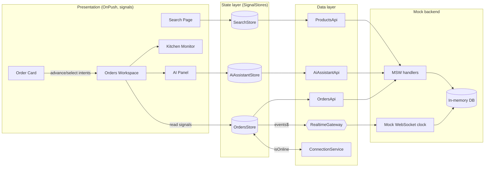
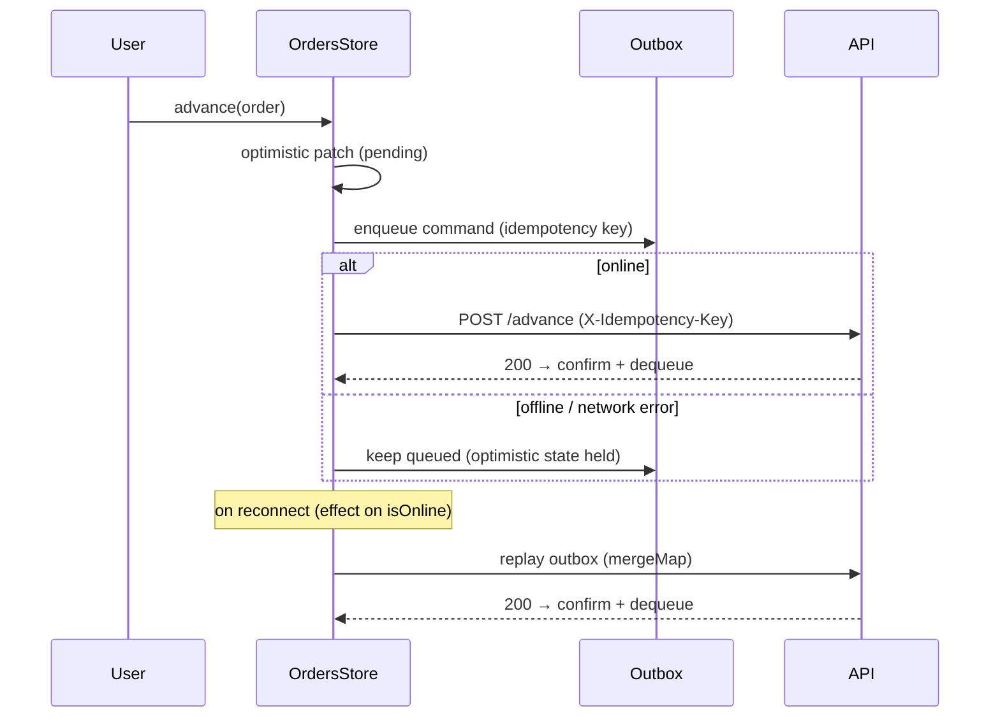

# Architecture Deep Dive

This document backs the walkthrough video's "engineering deep dive" section.

## 1. High-level data flow



**Rule of thumb:** data flows *down* as signals, intents flow *up* as outputs, and every
side effect (HTTP, realtime, timers) lives in the data layer — never in a component.

## 2. Reactive pipelines (RxJS operator choices)

| Pipeline | Operators | Why |
| --- | --- | --- |
| Product search | `debounceTime` → `distinctUntilChanged` → `switchMap` | Absorb keystrokes, drop no-op queries, cancel superseded requests. |
| AI stream | `switchMap` → `scan` → `retry({delay})` → `catchError` | Cancel on new selection, fold NDJSON into a state machine, backoff-retry, terminal error. |
| Order mutations | `mergeMap` → `tap`/`catchError` | Parallelism across orders; per-order dedupe guard prevents same-order races. |
| Realtime merge | `share` + `switchMap(events$)` | One multicast socket; merge pushes into entity state. |

## 3. The AI assistant state machine

```
        request(orderId)
idle ──────────────────► loading
                            │ first token
                            ▼
                        streaming ──(more tokens)──┐
                            │  ◄──────────────────┘
                            │ result chunk
                            ▼
                         success
   error ◄── (retries exhausted) ── loading
     │ retryNow()
     └────────────────────► loading
```

Modelled as a discriminated union (`AiAssistantState`). The template `@switch`es on
`status`, so a missing state is a compile error, not a runtime blank.

## 4. Offline command flow



Idempotency keys make replay safe even if a response was lost mid-flight (the server
dedupes on the key), and a per-order guard prevents duplicate user actions.

## 5. Change detection strategy

- **Zoneless**: `provideZonelessChangeDetection()` — no Zone.js. The framework only
  re-renders in response to signal changes, not on every `setTimeout`/`fetch`/event.
- Presentational components are **`OnPush`** and read `input()` signals, so they re-render
  only when their specific inputs change reference.
- Derived view state (`columns`, counts, priorities) uses **`computed`**, which memoises
  and recomputes lazily.
- `@for` uses **`track`** to reuse DOM nodes across realtime updates.

Net effect: a `kitchen-load` push updates the monitor and any changed priority badges —
not the whole board.

## 6. State management trade-off table

| Option | Pros | Cons | Verdict |
| --- | --- | --- | --- |
| **SignalStore + RxJS** (chosen) | Minimal boilerplate, native signals, `computed` granularity, `rxMethod` for effects, first-class zoneless fit | Newer API surface; entity helpers less battle-tested than `@ngrx/entity` | ✅ Best fit for this scope & Angular 21 |
| Classic NgRx Store | Mature, powerful devtools, strict unidirectional | Heavy boilerplate (actions/reducers/effects/selectors) for a mid-size app | Overkill here |
| Component Store | Local, scoped | Doesn't cover cross-feature shared state (orders + kitchen) | Insufficient |
| Plain services + `BehaviorSubject` | Zero deps | Re-implements what SignalStore gives; easy to get CD/leaks wrong | Reinventing the wheel |

## 7. Scaling to hundreds of screens

- **Feature-sliced folders + lazy routes**: every new screen is an isolated vertical slice
  with its own `data/`, `components/`, `pages/`. It ships as its own chunk; the shell never
  grows.
- **Contracts in `core`**: shared domain types and DI tokens (`RealtimeGateway`) keep
  features decoupled — teams work in parallel without merge collisions.
- **`shared/ui` → component library**: promote to a versioned package with Storybook once
  multiple squads consume it.
- **Store-per-feature**: `providedIn: 'root'` singletons for cross-cutting state (orders,
  kitchen), route-scoped providers for screen-local state — no global god-store.
- **Transport abstraction**: swapping mock → real backend, or REST → gRPC-web, is contained
  in `*.api.ts` + the gateway provider.
- **Consistent patterns**: the same debounce/switchMap/retry/optimistic recipes documented
  here become the house style, so screen #200 looks like screen #2.
